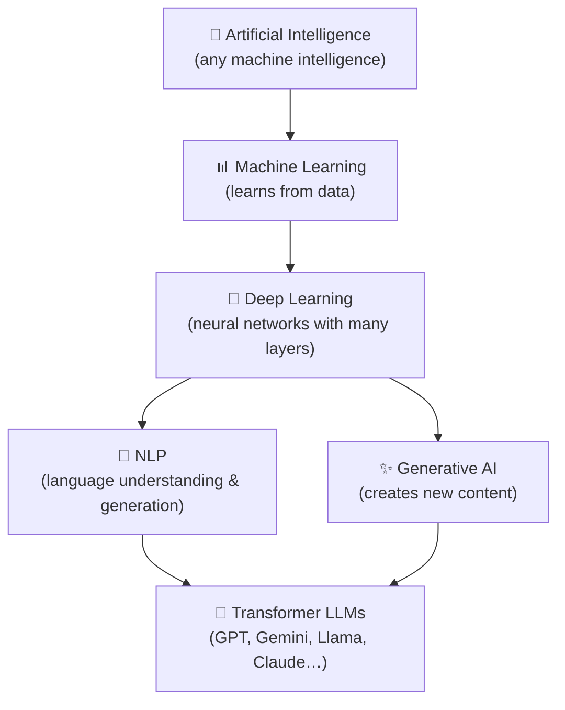

# Module 00 — Foundations: What Are LLMs and Why Do They Matter?

> **Estimated time:** 2–3 hours &nbsp;|&nbsp; **Prerequisites:** None &nbsp;|&nbsp; **Next module:** [02 — LLM Fundamentals](../02_llm_fundamentals/README.md)

---

## Learning Objectives

By the end of this module you will be able to:

1. **Explain** the relationship between AI, Machine Learning, Deep Learning, NLP, and Generative AI in plain language.
2. **Describe** what a Large Language Model (LLM) is, using a concrete analogy.
3. **List** at least five things LLMs do well and five things they do poorly or cannot do reliably.
4. **Distinguish** between a model, an algorithm, training, and inference.
5. **Explain** what model parameters and context windows are — intuitively, without math.
6. **Define** hallucinations and explain *why* they are a fundamental, architectural limitation rather than a bug to be patched.
7. **Trace** the end-to-end flow of a simple LLM application from user input to response.
8. **Read** and critically evaluate claims about AI capabilities in the media.

---

## The AI Family Tree

People use "AI", "ML", "LLM", and "GPT" almost interchangeably in casual conversation. They are not the same thing. Here is the precise hierarchy:

### Artificial Intelligence (AI)
The broadest category. AI is **any technique that enables machines to simulate human-like intelligence** — this includes rule-based expert systems from the 1980s, chess engines, image classifiers, and LLMs. If a program makes a decision or produces an output that requires something resembling reasoning, it lives somewhere in AI.

### Machine Learning (ML)
A *subset* of AI. Instead of being programmed with explicit rules ("if the email contains 'Nigerian prince', mark as spam"), ML systems **learn patterns from data**. You feed the system thousands of spam/not-spam examples and it extracts the rules itself. Classical ML algorithms include linear regression, decision trees, random forests, and support vector machines.

### Deep Learning (DL)
A *subset* of ML. Deep learning uses **artificial neural networks with many layers** (hence "deep"). Each layer learns increasingly abstract features from raw data. Deep learning powers modern image recognition, speech synthesis, translation, and — critically — LLMs.

### Natural Language Processing (NLP)
A *field* (not strictly a subset) that sits across AI and ML, focused specifically on **understanding, generating, and transforming human language**. Before LLMs, NLP tasks (sentiment analysis, named entity recognition, translation) were solved with separate specialist models. LLMs unified most NLP tasks into a single architecture.

### Generative AI (GenAI)
A *category* of AI models that **generate new content** — text, images, audio, video, code — rather than just classifying or predicting. LLMs are the dominant form of text-based Generative AI.

### The Hierarchy at a Glance



> [!NOTE]
> NLP existed long before deep learning (think: spell checkers, rule-based parsers). Modern LLMs made deep-learning-based NLP the dominant paradigm, but the field is broader than LLMs alone.

---

## What Is a Large Language Model?

**The one-sentence definition:** An LLM is a neural network trained on enormous amounts of text to predict the next token (word-piece) in a sequence, and through that single objective, it develops rich representations of language, facts, reasoning patterns, and style.

### The Autocomplete Analogy

Your phone's keyboard suggests the next word as you type. An LLM is **autocomplete on steroids**:

| Feature | Phone autocomplete | LLM |
|---|---|---|
| Trained on | Your messages | Trillions of words from the web, books, code, etc. |
| Prediction window | ~3 words of context | Thousands to millions of tokens of context |
| Output quality | "the", "I", "a" | Coherent essays, working code, detailed analysis |
| Knowledge | None | Broad world knowledge (up to training cutoff) |

The model was never explicitly taught facts like "Paris is the capital of France." It learned that fact because the sentence pattern `"… Paris, the capital of France …"` appeared millions of times during training, making that completion highly probable.

### Tokens, Not Words

LLMs don't read words — they read **tokens**, which are chunks of characters. "unhappiness" might become `["un", "happi", "ness"]` (3 tokens). The model learns relationships between tokens, not between English words per se. This is why LLMs sometimes struggle with character-level tasks like counting letters.

---

## What LLMs Can and Cannot Do

### ✅ LLMs are good at:
- **Summarising** long documents into concise bullet points
- **Drafting** emails, essays, code, cover letters, and marketing copy
- **Translating** between languages
- **Answering factual questions** that are well-represented in training data
- **Explaining** complex topics in plain language
- **Brainstorming** — generating many diverse ideas quickly
- **Reformatting** data (e.g., "convert this JSON to a Markdown table")
- **Writing and explaining code** in most popular languages
- **Carrying on a coherent, contextual conversation**

### ❌ LLMs are unreliable or incapable at:
- **Precise arithmetic** — they often get multi-step math wrong (use a calculator tool instead)
- **Real-time information** — they have a training cutoff; they don't know today's news
- **Guaranteed factual accuracy** — they hallucinate plausible-sounding but false information
- **Logical deduction over long chains** — they drift from premises
- **Spatial reasoning** — "which is to the left of the other?" questions trip them up
- **Consistent identity** — they have no persistent memory between sessions by default
- **Accessing private or local data** unless explicitly provided in the prompt
- **True understanding** — they produce outputs statistically similar to training data; whether this is "understanding" is philosophically contested

---

## Core Vocabulary: Model, Algorithm, Training, Inference

| Term | Plain English |
|---|---|
| **Algorithm** | A recipe — the mathematical procedure (e.g., gradient descent, attention mechanism) used to process data. |
| **Model** | The trained product of running an algorithm on data. Think of it as the "finished recipe dish" — the weights file you download. |
| **Training** | The process of adjusting a model's internal numbers (parameters/weights) by showing it vast amounts of data and measuring prediction errors. Happens once (or periodically) and is very expensive. |
| **Inference** | Running a trained model on new input to get an output. This is what happens when you send a message to an LLM. Much cheaper than training. |
| **Fine-tuning** | Additional training of an already-trained model on a smaller, specialized dataset to adapt its behaviour. |

---

## Parameters and Context Windows — Intuitively

### Parameters (Weights)
A neural network is a giant mathematical function with billions of knobs called **parameters** (also called weights). Training adjusts all these knobs until the model's predictions match the training data well.

- **GPT-2 (2019):** 1.5 billion parameters
- **GPT-3 (2020):** 175 billion parameters
- **Modern frontier models (2024–2025):** Estimated 400B–2T+ parameters (often undisclosed)

More parameters ≠ automatically better. Architecture, training data quality, and training technique matter enormously. A well-trained 7B model can outperform a poorly-trained 70B model on specific tasks.

**Analogy:** Parameters are like the synaptic connection strengths in a human brain. After training, they encode everything the model "knows."

### Context Window
The context window is **how much text the model can see at once** when generating a response — the maximum length of the conversation (prompt + response) measured in tokens.

- Early GPT-3: 4,096 tokens (~3,000 words)
- GPT-4 Turbo: 128,000 tokens (~96,000 words)
- Gemini 1.5 Pro: 1,000,000 tokens (~750,000 words)

**Why it matters:** The model cannot reason about text outside its context window. If your document is longer than the window, you must chunk it. If your conversation is longer than the window, early messages get dropped.

**Analogy:** The context window is your working memory. You can only actively think about what fits "on your desk." Long-term storage (parametric memory) is baked into weights during training, but you can only actively use what's in the current context.

---

## Hallucinations: A Fundamental Limitation

### What is a hallucination?
An LLM **hallucination** is when the model generates text that is **confidently stated but factually false**. Examples:
- Fabricating a citation to a paper that does not exist
- Inventing a biography detail for a real person
- Claiming a law says something it does not say
- Making up a function in a programming library

### Why does it happen?
Remember: the model's only objective during training was to predict the next token. It learned to produce **plausible continuations**, not **true statements**. The model has no internal truth detector — it has no way to query a database of facts. It generates text that *looks like* the kind of answer a knowledgeable person would write.

When asked a question whose true answer is rare or absent in training data, the model's "best guess" at a plausible continuation is often an invented fact stated with full confidence.

### Why can't we just fix it?
Hallucinations are not a bug in the code — they are **an emergent property of the training objective itself**. Some mitigations exist:
- **Retrieval-Augmented Generation (RAG):** Provide real documents in the context so the model can quote from them.
- **Tool use / function calling:** Let the model invoke a calculator or search engine.
- **RLHF / RLAIF:** Human feedback training reduces but does not eliminate hallucinations.
- **Grounding prompts:** "Only answer based on the following document…"

But no current technique eliminates hallucinations entirely. Always verify important factual claims from LLM output with authoritative sources.

> [!CAUTION]
> Never use LLM output as-is for medical, legal, or financial decisions without independent expert verification. Confident-sounding wrong answers are more dangerous than obvious wrong answers.

---

## How an LLM Application Works End-to-End

Here is the flow for a simple LLM-powered application (like a chatbot):

```
User types a message
       │
       ▼
┌─────────────────────────┐
│  Application code       │  ← Your Python script
│  - Builds the prompt    │
│  - Manages history      │
│  - Calls the API        │
└────────────┬────────────┘
             │  HTTPS request (prompt + parameters)
             ▼
┌─────────────────────────┐
│  Model provider servers │  ← Gemini, OpenAI, Anthropic, etc.
│  - Tokenise the input   │
│  - Run transformer      │
│  - Sample next tokens   │
│  - Detokenise output    │
└────────────┬────────────┘
             │  JSON response (generated text + metadata)
             ▼
┌─────────────────────────┐
│  Application code       │
│  - Parses the response  │
│  - Updates history      │
│  - Displays to user     │
└─────────────────────────┘
```

In later modules you will implement each of these steps.

---

## Key Takeaways

- AI is the broadest category; LLMs are a specific, modern sub-category.
- LLMs work by predicting the next token — everything else emerges from that.
- Parameters encode knowledge; the context window is working memory.
- LLMs are powerful for language tasks but unreliable for precise facts, math, and real-time data.
- Hallucinations are structural, not a bug — plan your applications accordingly.
- Training is expensive and rare; inference is cheap and happens on every API call.

---

## Next Step

➡️ **[Module 02 — LLM Fundamentals](../02_llm_fundamentals/README.md):** Dive into transformer architecture, tokenisation, inference parameters, and the model landscape.

> [!NOTE]
> Module 01 is reserved for environment setup. If you haven't set up your Python environment and API keys yet, do that before proceeding.
