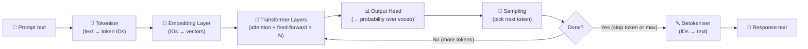

# Module 02 — LLM Fundamentals: How Transformers Work

> **Estimated time:** 2–3 hours &nbsp;|&nbsp; **Prerequisites:** Module 00 Foundations &nbsp;|&nbsp; **Next module:** [03 — Model APIs](../03_model_apis/README.md)

---

## Learning Objectives

By the end of this module you will be able to:

1. Describe the transformer architecture at a conceptual level — no math required.
2. Explain what "attention" means in the context of language models.
3. Explain why the context window is a hard constraint on LLM reasoning.
4. Distinguish between pre-training and post-training (instruction tuning, RLHF).
5. Correctly interpret and set inference parameters: `temperature`, `max_tokens`, `top_p`, `top_k`.
6. Explain why different models produce different outputs given identical prompts.
7. Recognise the major model families and know where each comes from.

---

## The Transformer Architecture — No Equations Required

The transformer is the neural network architecture that powers every modern LLM. Introduced in the 2017 paper *"Attention Is All You Need"* (Vaswani et al.), it replaced earlier recurrent architectures (RNNs, LSTMs) and became the foundation of the field.

You do **not** need to understand the mathematics to build effective LLM applications. But understanding the intuition will help you write better prompts and debug unexpected outputs.

### Step 1 — Tokenisation

Before any processing occurs, the input text is split into **tokens** — sub-word chunks that live in a fixed vocabulary.

```
"The astronaut floated weightlessly" 
→ ["The", " astron", "aut", " float", "ed", " weight", "lessly"]
→ [464, 31674, 315, 12014, 291, 4785, 1230]   ← token IDs (integers)
```

Each token ID maps to a high-dimensional vector (its **embedding**) that encodes meaning. Similar words end up near each other in this embedding space.

### Step 2 — Self-Attention: "What Matters Here?"

This is the core innovation of transformers. For each token, **self-attention** asks: *"Which other tokens in the sequence are most relevant to understanding this token right now?"*

**Example:** In the sentence `"The bank by the river was steep"`, the word `"bank"` needs to attend strongly to `"river"` (not `"money"`) to resolve its meaning. Self-attention learns to assign high weight to `"river"` and low weight to tokens that don't help.

Think of it like a spotlight: when the model processes each word, attention lets it shine the spotlight on other words in the prompt that are most informative.

**Multi-head attention** runs this process in parallel with different "spotlight configurations" (heads), letting the model simultaneously track multiple types of relationships: grammatical, semantic, coreference, etc.

### Step 3 — Transformer Layers (Stack Them Deep)

A transformer is many attention + feed-forward layers stacked on top of each other:
- **Early layers:** capture local patterns — grammar, syntax, adjacent word relations
- **Middle layers:** build phrase-level representations — "the frustrated customer" as a unit
- **Later layers:** reason about high-level meaning — topics, intent, logic

Modern LLMs have 32 to 96+ such layers.

### Step 4 — Output Head: Pick the Next Token

After all layers have processed the context, a final linear layer produces a **probability distribution** over the entire vocabulary — the probability that each token is the best next token. The model samples from this distribution (more on how below in inference parameters).

### Why Context Window Matters

Self-attention computes relationships between **every pair of tokens** in the sequence. The cost of attention grows **quadratically** with sequence length. This means:

- A 2× longer context costs ~4× more compute.
- There's a hard maximum imposed by the model's architecture (its positional encoding scheme).
- Tokens beyond the context window are simply invisible to the model — not degraded, gone entirely.

**Practical impact:** If you're building an app that processes long documents, you must plan for chunking or summarisation strategies. You cannot simply pass an arbitrarily long document and expect the model to handle it.



---

## Pre-Training vs Post-Training

### Pre-Training
The model is trained on a massive corpus — Common Crawl, books, code repositories, Wikipedia — with the simple objective: **predict the next token**. This phase:

- Uses hundreds of thousands of GPU-hours
- Costs millions to tens of millions of dollars
- Bakes in world knowledge, language patterns, reasoning templates
- Produces a **base model** that can continue any text but isn't great at following instructions

### Post-Training: Making the Model Useful

After pre-training, the base model needs to be shaped into a useful assistant. This happens in stages:

#### Supervised Fine-Tuning (SFT) / Instruction Tuning
Humans write thousands of (prompt, ideal response) pairs. The model is fine-tuned on these examples, learning to follow instructions in a question-answer format. This is why you can ask "Explain X" and get an explanation instead of a random continuation.

#### Reinforcement Learning from Human Feedback (RLHF)
Human raters compare two model outputs and pick the better one. A **reward model** is trained to predict human preference. Then the LLM is fine-tuned with RL to maximise the reward model's score. This is how models learn to be helpful, harmless, and honest.

#### RLAIF / Constitutional AI
Instead of human raters, another AI model evaluates outputs against a set of principles (a "constitution"). More scalable than pure RLHF.

> [!NOTE]
> When you use Gemini, GPT-4, or Claude, you're using post-trained models, not raw base models. The safety guardrails, instruction-following ability, and conversational style all come from post-training, not pre-training.

---

## Inference Parameters

When you call an LLM API, you can control how the model samples its next token at each step. These parameters dramatically affect output style and quality.

### `temperature`

**What it controls:** The "sharpness" of the probability distribution before sampling.

- **Low temperature (0.0–0.3):** The probability mass concentrates on the single most likely token. Outputs are deterministic, focused, and repetitive.
- **Medium temperature (0.5–0.9):** Balanced — coherent and fluent, with some variety.
- **High temperature (1.0–2.0):** The distribution flattens. Less likely tokens get sampled more often. Outputs are more varied, surprising, and sometimes incoherent.

**Example — same prompt at different temperatures:**

> **Prompt:** "The sky is"

| Temperature | Possible output |
|---|---|
| `0.1` | "The sky is blue." |
| `0.7` | "The sky is painted in hues of amber and violet." |
| `1.5` | "The sky is a phosphorescent cathedral of forgotten radio signals." |

> [!WARNING]
> **Common mistake:** Temperature is NOT a creativity dial and NOT an intelligence dial. At high temperatures, the model isn't thinking harder — it's sampling less likely tokens. This can produce novelty but also nonsense. For tasks requiring precision (code, data extraction, factual Q&A), keep temperature low (0.0–0.2).

### `max_tokens` / `max_output_tokens`

The maximum number of tokens the model will generate in its response. Use this to:
- Prevent runaway responses that consume quota
- Force the model to be concise
- Control API costs

Setting it too low can cut off responses mid-sentence.

### `top_p` (nucleus sampling)

Instead of considering all possible next tokens, `top_p` restricts sampling to the **smallest set of tokens whose cumulative probability reaches `p`**.

- `top_p=0.9`: Only consider tokens that together account for 90% of the probability mass.
- `top_p=1.0`: Disable nucleus sampling (consider all tokens).

This cuts off the "long tail" of very unlikely tokens even at high temperatures.

### `top_k`

Restricts sampling to the **top K most likely next tokens** (by raw probability). 

- `top_k=1`: Always pick the most likely token (greedy decoding — similar to `temperature=0`).
- `top_k=40`: Sample from the 40 most likely tokens.

**`top_p` vs `top_k`:** `top_p` adapts dynamically to the distribution; `top_k` is a fixed count. Many practitioners prefer `top_p`. Some APIs let you set both (they apply jointly).

### Parameter Summary

| Parameter | Low value effect | High value effect | Typical use |
|---|---|---|---|
| `temperature` | Deterministic, focused | Varied, unpredictable | 0.0 for extraction; 0.7–1.0 for creative tasks |
| `max_tokens` | Short responses | Long responses | Set to 2× your expected output |
| `top_p` | More constrained | Consider full vocab | 0.95 is a safe default |
| `top_k` | Greedy | Wide vocabulary sampling | Often left at provider default |

---

## Why Different Models Produce Different Outputs

Given the exact same prompt, Gemini 2.0 Flash and GPT-4o will produce different responses. Why?

1. **Different training data:** Different portions of the internet, books, code.
2. **Different architectures:** Layer counts, attention heads, embedding dimensions.
3. **Different post-training:** Different RLHF raters, different reward model objectives.
4. **Different default sampling parameters:** Each provider sets defaults for temperature, top_p, etc.
5. **Different tokenisers:** Even the same text becomes different token sequences.
6. **Stochastic sampling:** Even the same model with `temperature > 0` won't give identical output twice.

This means **you cannot assume prompts are portable between models**. A prompt carefully tuned for GPT-4 may need adjustment for Gemini.

---

## Model Families Overview

| Family | Organisation | Key characteristics |
|---|---|---|
| **Gemini** (Flash, Pro, Ultra) | Google DeepMind | Multi-modal (text, image, audio, video), very long context (up to 2M tokens), tight Google ecosystem integration |
| **GPT** (GPT-4o, GPT-4o-mini) | OpenAI | Pioneered the space, strong reasoning, broad ecosystem, widely used as a benchmark |
| **Claude** (Haiku, Sonnet, Opus) | Anthropic | Known for long context, safety-focused, strong at following complex instructions |
| **Llama** (Llama 3.x, Llama 4) | Meta | Open-weights (download and run locally), powers many third-party fine-tunes |
| **Mistral** (7B, 8x7B, Large) | Mistral AI | Efficient open-weights models, strong multilingual, sliding window attention |
| **Gemma** (2B, 7B, 27B) | Google DeepMind | Smaller open-weights models from Google, optimised for on-device use |
| **DeepSeek** (V3, R1) | DeepSeek | Strong coding/math, open-weights, cost-competitive with frontier models |

> [!TIP]
> For learning and experimentation, use **Gemini Flash** (fast, cheap, generous free tier) or **DeepSeek R1 Free** via OpenRouter (no cost). Save the expensive frontier models for tasks that actually require them.

---

## Common Mistakes

| Mistake | Why it's wrong |
|---|---|
| "Temperature controls how creative/smart the model is" | Temperature only controls sampling randomness. A high-temp dumb model is still dumb. |
| "Higher temperature = better answers" | Higher temperature increases diversity but also error rate. |
| "The model read the internet and knows everything" | Knowledge has a training cutoff. Recent events are unknown. |
| "The model 'thinks' — it has understanding" | It generates statistically likely token sequences. Whether this constitutes understanding is unresolved. |
| "More parameters always means better" | Model quality depends on training data, technique, post-training — not just size. |

---

## Exercises

1. **Temperature exploration:** Using the API (you'll set it up in Module 03), send the same creative writing prompt with `temperature=0.1` and `temperature=1.2`. Compare the outputs.
2. **Context window experiment:** Paste a very long document into a prompt and note at what length the model starts losing track of details from the beginning.
3. **Model comparison:** Send the same factual question to two different models via OpenRouter. Note differences in style, detail, and accuracy.
4. **Sampling parameters:** Try setting `top_p=0.5` (very constrained) vs `top_p=1.0` (unconstrained) at the same temperature. What changes?

---

## Next Step

➡️ **[Module 03 — Model APIs](../03_model_apis/README.md):** Get your API keys, make your first real API call, and learn to handle errors like a professional.
