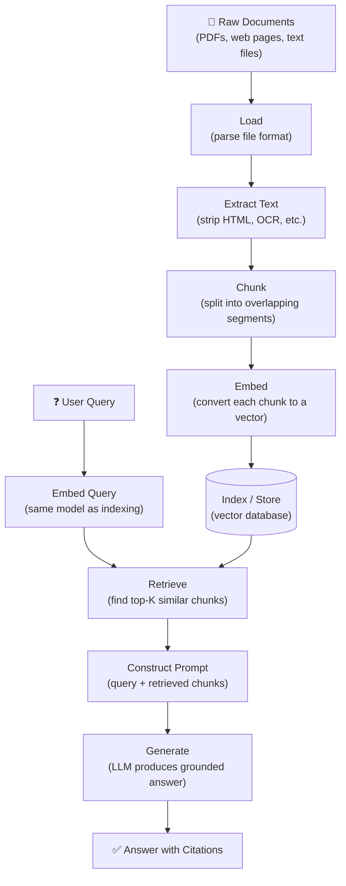

# Module 13 — RAG Fundamentals (Retrieval-Augmented Generation)

> **Goal:** Understand what RAG is, why it reduces hallucinations for domain-specific knowledge, and how each stage of the RAG pipeline works — from document loading to grounded answer generation.

---

## 1. What is RAG and Why Does it Exist?

LLMs have two fundamental limitations for domain-specific knowledge:

1. **Knowledge cutoff** — the model was trained on data up to a certain date and knows nothing about events after that.
2. **Hallucination** — when asked about facts it doesn't know, the model often generates plausible-sounding but incorrect information rather than admitting ignorance.

**RAG (Retrieval-Augmented Generation)** solves both problems by giving the model relevant documents at query time:

```
Instead of:  "What is our refund policy?"  →  [model guesses from training data]

RAG does:    "What is our refund policy?"
                    ↓
             [search your policy docs]
                    ↓
             "Here are the relevant sections: ..."  →  model reads and answers
```

The model is only as hallucination-prone as its retrieved context. If the right document is retrieved, the model can cite it accurately.

---

## 2. The Full RAG Pipeline



---

## 3. Each Stage Explained

### Stage 1 — Load

Convert raw files into plain text. Different loaders handle different formats:

| Source | Tool |
|--------|------|
| PDF | `pypdf`, `pdfplumber`, `pymupdf` |
| Web page | `BeautifulSoup`, `trafilatura` |
| Word doc | `python-docx` |
| Plain text | `open()` |

### Stage 2 — Extract Text

After loading, clean the text:
- Remove headers/footers (PDFs)
- Strip HTML tags (web pages)
- Normalise whitespace
- Remove boilerplate (cookie banners, navigation menus)

### Stage 3 — Chunk

Split the document into smaller pieces so each chunk fits in the embedding model's token limit and contains a coherent unit of information.

```python
def chunk_text(text, chunk_size=300, overlap=50):
    words = text.split()
    chunks = []
    for i in range(0, len(words), chunk_size - overlap):
        chunk = " ".join(words[i : i + chunk_size])
        chunks.append(chunk)
        if i + chunk_size >= len(words):
            break
    return chunks
```

Chunking strategy is one of the highest-leverage decisions in RAG:
- Too small → chunks lack context.
- Too large → dilutes the embedding; retrieves irrelevant surrounding text.

### Stage 4 — Embed

Convert each chunk to a vector using an embedding model.

```python
embedding = embed_model.embed(chunk_text)  # → [0.12, -0.45, ...]
```

**Critical rule:** use the same embedding model for indexing and querying.

### Stage 5 — Index

Store the vectors in a vector database so you can efficiently find the most similar vectors to a query.

| Option | Best for |
|--------|---------|
| In-memory dict (this module) | Learning and prototyping |
| ChromaDB | Local dev, small-medium datasets |
| Pinecone / Weaviate | Production, large scale |
| pgvector | If you already use PostgreSQL |

### Stage 6 — Query Embed

At query time, embed the user's question using the **same model** used during indexing.

### Stage 7 — Retrieve

Find the top-K chunks whose vectors are most similar (highest cosine similarity) to the query vector. K is typically 3–10.

### Stage 8 — Construct Prompt

Build the prompt that the LLM will see:

```
System: You are a helpful assistant. Answer using ONLY the provided context.
        If the context doesn't contain the answer, say "I don't know."

Context:
[Chunk 1 text — source: policy.pdf, chunk 3]
[Chunk 2 text — source: policy.pdf, chunk 7]
[Chunk 3 text — source: faq.txt, chunk 1]

User: What is the refund window for digital purchases?
```

### Stage 9 — Generate

The LLM reads the context and produces a grounded answer. Because the relevant text is right there in the prompt, it doesn't need to "remember" the answer — it just reads and summarises.

---

## 4. Source Attribution and Citations

A major advantage of RAG over pure LLM generation is **traceability**. Each retrieved chunk knows where it came from, so you can include citations:

```
Answer: Digital purchases can be refunded within 14 days of purchase.
Sources:
  - policy.pdf, section 4.2 (similarity: 0.91)
  - faq.txt, question 12 (similarity: 0.84)
```

This allows users to verify the answer and builds trust. It also helps you debug retrieval failures.

---

## 5. Common Failure Modes

| Failure | Symptom | Fix |
|---------|---------|-----|
| Wrong chunk retrieved | Answer is off-topic or wrong | Improve chunking or embedding model |
| Answer not grounded in context | Model ignores retrieved chunks, makes stuff up | Strengthen system prompt; add grounding instructions |
| Query-document mismatch | Query uses different vocabulary than documents | Use hybrid search (BM25 + vector) |
| Chunks too large | Relevant fact diluted in long chunk | Reduce chunk size |
| Missing information | Answer says "I don't know" for known facts | Check if document was loaded; check chunk boundaries |

---

## 6. When RAG is Better Than Fine-Tuning

| Approach | When to use |
|----------|------------|
| **RAG** | Knowledge changes frequently; need citations; facts are in documents; domain knowledge must be auditable |
| **Fine-tuning** | Behaviour/style changes (tone, format, persona); knowledge is stable; latency is critical; no retrieval step affordable |

RAG is almost always the right first step for adding domain knowledge to an LLM. Fine-tuning is expensive and inflexible — it "bakes in" facts that may become outdated.

> **Rule of thumb:** If you can write the answer in a document, use RAG. If you need the model to *behave* differently, consider fine-tuning.

---

## 7. Exercises

### Exercise 1 — Observe Each Stage
Run `01_rag_pipeline.py` with `VERBOSE = True`. Read the output for each stage: load, chunk, embed, retrieve. How many chunks were created? Which chunk scored highest for your query?

### Exercise 2 — Change the Query
Modify the query in the script. Does the retrieved chunk change? Try a query that is semantically similar to a chunk but uses different words. Does it still retrieve the right chunk?

### Exercise 3 — Add a Document
Add a short paragraph to the built-in corpus on a completely new topic. Write a query that should retrieve it. Does it work?

### Exercise 4 — ChromaDB Mode
Install `chromadb` (`pip install chromadb`) and re-run the script. Compare the results against the in-memory mode. Are retrieved chunks the same?

### Exercise 5 — Citation Filter
Modify the prompt construction to only include chunks with a similarity score above 0.5. What happens when no chunk passes the threshold?

---

## Key Takeaways

- RAG grounds the LLM's answer in retrieved documents, reducing hallucination.
- The pipeline: load → extract → chunk → embed → index → (at query time) embed → retrieve → prompt → generate.
- Chunking strategy is critical — chunk size and overlap affect retrieval quality dramatically.
- Use the **same embedding model** for both indexing and querying.
- Include source attribution so answers can be verified.
- RAG is almost always preferable to fine-tuning for adding domain knowledge.
